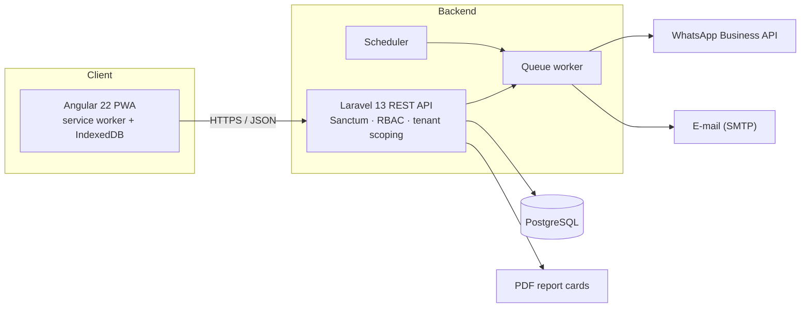
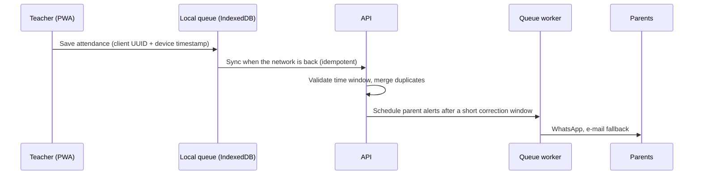

# Lakol — School & University Management Platform

> A multi-tenant SaaS that lets schools and universities in Niger manage students, timetables, attendance, grades, report cards and fees — and automatically keeps parents informed, even when the network is unreliable.

**Role:** Solo developer — product design, REST API, Angular PWA and automated tests.

> 🔒 This repository contains documentation and visuals only. The source code is proprietary and private. See [Intellectual property](#intellectual-property).

---

## Why Lakol

Schools need to know who is in class, how students are performing and who has paid — and parents want to be told quickly when something goes wrong. In practice, connectivity and power are intermittent, so a tool that only works online is a tool that gets abandoned.

Lakol is built around that constraint: **teachers can take attendance without a network, parents are notified reliably, and administrators get a clear, audited view of the whole institution.**

---

## Product overview

Lakol is one application with three role-based workspaces. Menus and actions adapt to the permissions returned by the API.

| Workspace | Users | What they do |
|---|---|---|
| **Platform** | Platform owner | Onboard institutions, manage institution administrators, suspend or reactivate tenants, SaaS invoicing, audit log |
| **Institution** | Principal, academic office, accountant | Students (with Excel import), staff, courses, timetable, report cards, attendance monitoring, fees and cash desk, end-of-year rollover |
| **Teacher** | Teachers | Today's classes, offline attendance, timetable and make-up session requests, grade entry |

### Highlights

- **Academic structure** — academic years, terms, faculties/departments, programs, classes and subjects; a course links a class, a subject, a teacher and a year. Works for both secondary schools and universities.
- **Offline-first attendance** — teachers take attendance on a phone with no connection; it is stored locally and synced automatically when the network returns, without duplicates.
- **Automated parent communication** — absence alerts, daily summaries, make-up session notices and report cards, delivered by WhatsApp with e-mail as a fallback.
- **Timetable with conflict detection** — overlapping slots for a teacher or a class are rejected with a human-readable explanation; teachers can request dated make-up sessions that administrators approve or refuse.
- **Grades and report cards** — weighted averages, ranking with ties, honours, absences per term, and bulk PDF generation.
- **Finance** — tuition plans, payments, sequential receipts, balances and unpaid-fee tracking.
- **Year-end rollover** — prepare the next year, propose pass/repeat decisions from annual averages, then promote students while keeping a full enrollment history.
- **Bulk student import** — Excel/CSV with flexible column recognition, a row-by-row preview before anything is saved, and duplicate detection.

---

## Architecture

### Offline attendance flow

---

## Engineering highlights

These are the decisions I am most proud of, and the ones I am happy to discuss in an interview.

**Multi-tenancy and data isolation**
- Every institution's data is isolated at the query level through a reusable model trait, and identifiers received from the client are validated against the current tenant. Accessing another tenant's record returns a `404`, never a `403`, so existence is not leaked.

**Reliable notifications**
- Each parent is contacted through **one channel at a time** (WhatsApp first, e-mail only as a fallback) and a channel that already succeeded is never retried, even if a job is replayed.
- Every delivery attempt is logged per parent and per channel, with staggered retries for temporary failures.
- A scheduled safety net re-queues anything that was missed because of a crashed worker or a power cut.

**Offline-first PWA**
- Attendance is written to the device first, then synced through a persistent queue with client-generated IDs so the server can safely ignore duplicates.
- Read-only screens fall back to the last loaded data through a service-worker cache that is cleared on logout (shared computers). Write operations such as payments stay online-only on purpose, to avoid accounting errors from provisional receipt numbers.

**Security**
- Two-factor authentication (hashed, single-use, time-limited codes) for administrator roles, with optional trusted devices.
- Login throttling and identical responses whether or not an account exists.
- Role-bound API tokens with role-specific lifetimes, immediate blocking of disabled accounts and suspended tenants, and session revocation on password change.
- Immutable financial history: payments are cancelled with a reason, never deleted, and receipt numbers are sequential with no gaps.
- Append-only audit log for sign-ins, account changes, payments and suspensions.

**Performance and data integrity**
- Report-card PDFs are generated in batches and merged, keeping generation time practical for large classes.
- Enrollment history is stored per student, per year and per class, so past report cards and balances stay correct after a rollover.
- Business rules (averages, ranking, schedule conflicts, rollover) live in dedicated service classes rather than controllers.

**Quality**
- 70+ automated feature tests covering authentication, tenant isolation and permissions, attendance and notifications, finance, report cards and year-end, timetable, imports and super-admin flows.
- The suite runs on both PostgreSQL and SQLite.

---

## Tech stack

| Layer | Technologies |
|---|---|
| Backend | PHP 8.3, Laravel 13, Laravel Sanctum, queues and scheduler, dompdf + FPDI |
| Database | PostgreSQL 16 (MySQL 8 compatible) |
| Frontend | Angular 22 — standalone components, signals, zoneless; lazy-loaded workspaces |
| Offline / PWA | Angular service worker, IndexedDB |
| Messaging | WhatsApp Business API, SMTP e-mail |
| Testing | PHPUnit / Laravel feature tests |
| Tooling | GitHub Actions, Composer, npm |

---

<!--
SCREENSHOTS — uncomment this block once the images are in /screenshots.
Use anonymised demo data only, never real students, parents or institutions.

## Screenshots

> Replace the placeholders with anonymised screenshots (demo data only — never real students, parents or institutions).

| Institution dashboard | Timetable |
|---|---|
|  |  |

| Teacher attendance (mobile) | Report card |
|---|---|
|  |  |

| Cash desk | Platform admin |
|---|---|
|  |  |
-->

---

## Intellectual property

© 2026 Lakol. All rights reserved.

Lakol is a proprietary educational management platform developed by Mahamadou Allachi Boukar Allachi.

This repository contains project documentation and visual demonstrations only. The source code, architecture implementation and business logic are proprietary and may not be copied, modified, distributed or commercially exploited without prior written permission.

---

## Contact

**Mahamadou Allachi Boukar Allachi** — Full-stack engineer (Laravel · Angular), Niamey, Niger

- GitHub: [github.com/zolkid85](https://github.com/zolkid85)
- LinkedIn: [linkedin.com/in/boukar-allachi-mahamadou-allachi166568258](https://linkedin.com/in/boukar-allachi-mahamadou-allachi166568258)
- E-mail: [mahamadou.allachi98@gmail.com](mailto:mahamadou.allachi98@gmail.com)

Happy to walk through the product in a live demo and to discuss the architecture in detail.
